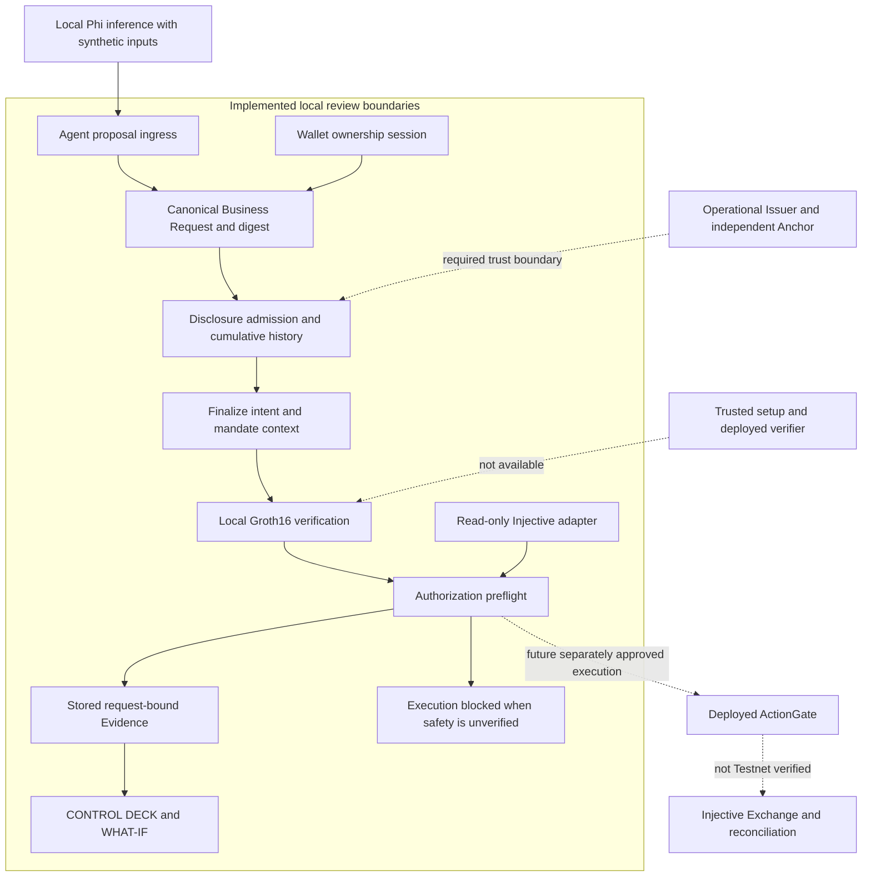
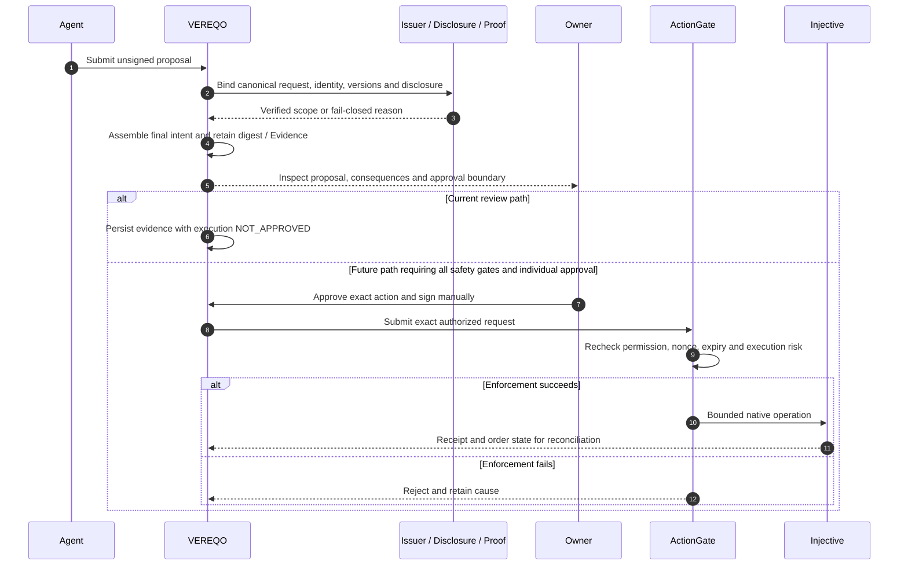
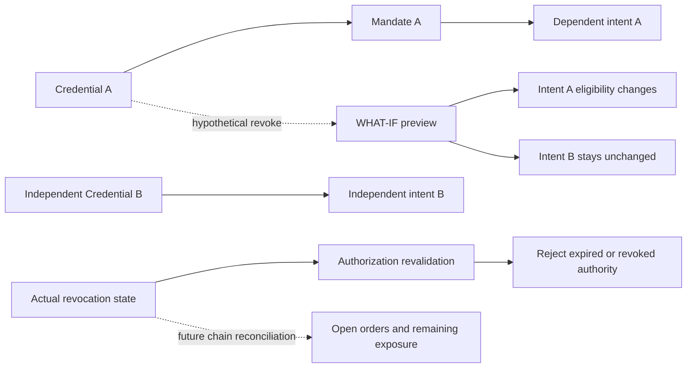
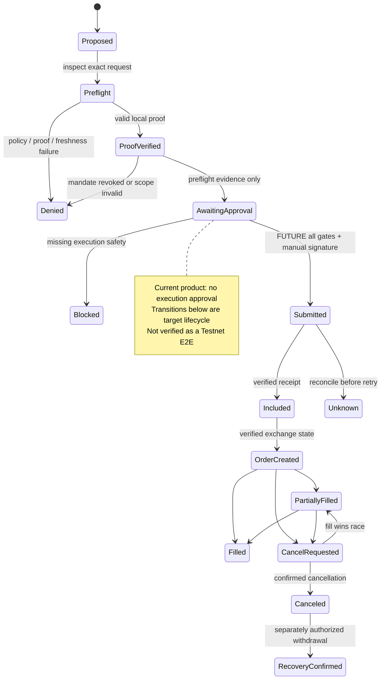

# VEREQO

**PROVE WHAT MATTERS. CONTROL WHAT FOLLOWS.**

**AIの金融Intentを理解し、必要な事実だけを検証し、その先の影響を正確に制御する。**

[English](README.md) · [日本語](README.ja.md)

## The Problem — A PROPOSAL IS NOT PERMISSION

金融Agentは数秒で注文を提案できます。それでもレビュー担当者には、誰の要求か、どの機密条件が適用されるか、どの権限が存在し、失効時に何が変わるかを確認する必要があります。

Proof、Wallet接続、取引Mandateは、それぞれ異なる事実を示します。一つの緑色の状態にまとめると、**この条件で、この特定の行動を許可できるか**という判断が見えなくなります。

VEREQOの出発点は、保護された情報そのものを公開せずに正確な質問へ回答し、その回答や権限に依存する判断の変化を可視化する、という課題でした。

## The Product — UNDERSTAND / SIMULATE / CONTROL

VEREQOは、Agentの要求と金融操作の間に置く意思決定用インストゥルメントです。

| モード | レビュー担当者が得るもの |
| --- | --- |
| **UNDERSTAND** | 提案、単位、取得元、権限、Evidenceを理解する。 |
| **SIMULATE** | CredentialやPolicyの仮想変更と、現在の依存関係を比較する。 |
| **CONTROL** | 開示の許可、所有者認証、Mandate、Proof、実行権限を明示的に扱う。 |

現在の製品は、動作するローカル開示・影響検査、Requestに結合したレビューとEvidence、Injective Testnetの読み取り専用観測を統合しています。金融実行は **NO-GO / NOT_IMPLEMENTED** です。

## Financial Use Case

想定顧客は、外部Agentへ制限付きの作業を委任する取引担当者、流動性提供者、リスク管理チーム、企業です。

例として、Agentが **40 INJを12 USDTで買うSpot BUY LIMIT注文**を提案したとします。最大想定元本は **480 USDT** です。これは **SYNTHETICな説明用の数値**であり、実相場や注文記録ではありません。

担当者は、非公開の上限を明かさず、Issuerが認めた私的Mandateがこの特定のエクスポージャーを許可するかを確認します。VEREQOではRequest、Proofの保証範囲、許される開示、Mandate、下流の依存関係を検査できます。最後のOwner署名と金融実行は別のゲートで扱います。

実際のローカルPhiモデルは、明示的な合成入力からSchemaに適合する未署名Proposalを生成しました。これは **LOCAL VERIFIEDな実推論**です。実市場での自律取引ではなく、その実験の後段で使われた合成アダプターも、運用Issuer・独立Anchor・金融E2Eの成功を意味しません。

## CONTROL DECK — White Instrument

選択した一つのRequestを軸に、精密ダイヤル、物理キーを模した操作、34バーLCD、有向依存関係、Evidence Inspectorがつながります。White Instrumentは抑制した余白と動きで、状態と原因を読み取れるよう設計しています。

| 表示領域 | 目的と現在の境界 |
| --- | --- |
| **Disclosure** | 回答を返す前に質問を審査し、累積したローカル履歴を保持する。有限の参照データは合成。 |
| **Consequence** | 明示的な有向依存関係をたどり、影響を受けるClaimと独立したClaimを確認する。 |
| **WHAT-IF** | 失効を確定せず、オンチェーン権限を変えずに適格性の変化を比較する。 |
| **Evidence** | 保存済みRequest ID、digest、version、判断、取得元を確認する。記録の読込はProofの再検証ではない。 |
| **Financial inspection** | Spot/Derivativeの下書きと、明示的に取得したTestnet観測を確認する。下書き操作は注文を送信しない。 |

合成開示デモでは候補集合が128 → 101 → 81へ絞られ、続く閾値70の質問は71/10の分割がPolicyに違反するため拒否されます。これは開示制限の動作を示すものであり、実金融ポートフォリオの保護実績ではありません。

## Why Injective

Injectiveは、想定する製品に具体的な金融操作の意味を与えます。

1. **ネイティブExchangeの意味体系：** Spot/Derivative市場、Subaccount、注文状態で金融Requestを具体化できる。
2. **EVMからExchangeへの境界：** Exchange PrecompileのインターフェースでSolidity Gateの接続先を定義できる。DirectとProxyの権限は別々に評価し、このプロトタイプはDirectを対象とする。
3. **Walletツール：** EIP-712とEVMツールにより、所有者認証と正確なIntentへの署名を明示できる。
4. **Agent接続：** Structured Proposalをレビュー層へ渡し、署名・送信をAgent権限の外に置ける。このリリースはInjective MCP統合を主張しない。
5. **権限を持つ資産：** Issuerによる制限はCredentialや資産単位Policyの将来ユースケースになる。本番資産との統合は未検証。
6. **結果の観測：** チェーンとExchangeの読取でReceiptと注文状態を照合できる。これは統合目標であり、実金融ライフサイクルの実証ではない。

EVM TestnetのChain ID **1439** とネイティブネットワーク **injective-888** は別のインターフェースです。独立したRPC・LCD・Indexerの観測は、同じ時点に原子的に固定された状態ではありません。

## System Architecture

実線は実装済みのローカルレビュー境界、破線は外部の信頼条件や将来の実行依存を表します。これは製品の構成図であり、**本番E2E配備の証拠ではありません**。Request IDは照合の手掛かりであり、digest・署名・検証にはそれぞれ限定された保証範囲があります。回路が実際に扱っていない外部フィールドを、Groth16回路内で証明済みとはしません。



## Request Lifecycle

Requestを正規化し、開示確定後に最終Intentを組み立てます。保存するdigestとversionでレビュー経路の整合を確認できます。運用Agent → 独立Issuer → 信頼済みProof → チェーン実行の全体は未実証です。



## Revocation & Dependencies

依存元の失効は、その依存先の適格性を変え、独立した要求の状態は保持しなければなりません。有効なProofでも失効済み権限を上書きできません。WHAT-IFはローカルの仮想比較です。実際の失効と既存注文の残存リスクには、別の権限と状態照合が必要です。ローカルグラフはこの区別を示し、実注文の照合経路は今後の対象です。



## Financial State Lifecycle

認可、送信、チェーン取込、注文作成、部分約定、取消、回収は別の状態です。図には将来の金融ライフサイクルも含みます。現在の製品はレビュー・事前検査のEvidenceを記録し、未承認または安全性未確認の実行を拒否します。注文ハッシュが返っても、それだけで約定は証明されません。



## Repository Structure / Technology

| パス | 技術と責務 |
| --- | --- |
| `apps/web/` | React、TypeScript、Vite。英語初期表示と明示的JP選択、正式ソリッドワードマーク、OFL付きローカルフォント。 |
| `packages/` | Request/Intent型、Policy、Disclosure、Consequence、金融ドメインアダプター。 |
| `services/issuer/` | Node.js HTTP境界、ローカルSQLite、認証、プレビュー記録。 |
| `contracts/` | Solidity ActionGate、Verifier接続口、Direct Exchange境界、Foundryテスト。 |
| `circuits/` | ローカルCircom回路ソース。本番Trusted Setupはない。 |
| `tests/` | Vitestの回帰・攻撃負例。ローカル/mockの結果は環境区分を保持する。 |
| `scripts/` | ローカル開発・検証ツール。過去のEvidence用ツールの一部はリリースから除外したローカル成果物を必要とする。 |

補足資料：[Architecture](docs/ARCHITECTURE.md)、[Security](docs/SECURITY.md)、[Release validation](docs/RELEASE_VALIDATION.md)。

## Verified Today / Not Yet Verified

以下は記録された証拠の要約であり、今回の新しい実ネットワーク・Session確認ではありません。独立した成功を運用E2E成功へ合算しません。

| 領域 | 記録された結果 | 残る条件 |
| --- | --- | --- |
| Wallet所有者認証 | **REAL・過去のPASS：** 実MetaMaskの所有者Sessionをサーバー検証済み。 | 短時間Sessionは失効済み。現在のSession・実行許可は推定しない。 |
| Phi Proposal | **LOCAL VERIFIED：** 実ローカル推論、入力は **SYNTHETIC**。 | 運用Agent/providerと、後段の独立した信頼境界は未実証。 |
| Groth16 | **LOCAL VERIFIED：** Proof生成・検証。 | 単一マシンSetupは本番で信頼しない。信頼済みセレモニーとVerifier配備は未完了。 |
| Disclosure / graph / WHAT-IF | ローカル審査、累積制限、依存関係の仮想比較、拒否経路を実装。 | 同じサーバーのSQLiteは独立Anchorではない。 |
| Evidence / CONTROL DECK | 保存記録のレビュー、digest・文脈の表示を実装。 | 表示だけでは暗号再検証や外部因果関係を証明しない。 |
| Injective / T5 | **TESTNET READ：** 読み取り専用観測を統合。未確認・危険な市場状態はfail-closed。 | 最後の記録では10秒以内の新鮮な両側板がなかった。Snapshotは署名前の観測に限る。 |
| T6 / ActionGate | **LOCAL** Foundry/mock検証。 | Testnetの配備、資金、注文、取消、出金、本人回収の完全E2Eは未実証。 |
| Release build | 記録された型検査・build PASS、英語初期表示 **2/2**。 | 今回の全体テスト件数は主張しない。日付付きRelease validationを参照。 |

Testnet取引、資金を持つGateの配備、自律的金融実行は主張しません。未完成の映像URLは掲載しません。非公開の生Evidence、Wallet映像、HAR、ローカルDBはリリースから除外しています。

## Roadmap / Next Milestones

1. 運用Agentと管理されたIssuerを設定し、実Credentialの発行・失効を検証する。
2. 履歴の単調増加とCAS競合拒否を持つ、独立した信頼境界のDisclosure Anchorを接続する。
3. 回路固有のTrusted Setupを完了し、対象Verifierの配備を検証する。
4. 新鮮な市場データと信頼できる実行時リスク検査を確立する。署名前の鮮度だけで保証しない。
5. 個別本人承認の下で、限定したTestnet Deposit → Order → Cancel/Withdraw/Recoveryを配備・照合する。
6. 一つのBusiness Requestを全運用境界で実証し、承認済み公開メディアと提出物を準備する。

## Run Locally / Tests / Security

Node.js `>=22.13.0 <23` または `>=24` とnpmが必要です。SolidityテストにはFoundryを使います。ローカルサービスはloopbackで起動し、参照デモには合成データを使用してください。

```sh
npm ci
npm run typecheck
npm run build
npm run dev
```

起動中は `http://127.0.0.1:5173/` を開きます。ローカルAPIはポート `4317` です。初回は英語で描画し、明示的に選んだ日本語設定は保持します。出力は `dist/web` です。将来のVercelではこの出力先を指定します。Deploy済みという意味ではありません。

```sh
npm test
npm run test:contracts
```

これらはローカルテストです。成功しても実金融実行を示しません。成果物依存のProof/Evidenceツールには、別途用意するローカル入力が必要です。過去の全体テスト件数を現在の結果として掲載していません。

前回リリース検査では、選別Snapshotと基底履歴の秘密情報検出は0件、production依存の脆弱性指摘は0件でした。開発ツールには低severity 15件が残り、中・高・criticalは0件、Viteにはchunkサイズ警告がありました。日付付きの結果であり、将来の脆弱性がないという保証ではありません。`.vercelignore`はビルド素材を保持し、ローカル状態・メディア・内部Evidenceを除外します。資格情報、Session Token、署名、HAR、SQLiteをCommitしないでください。

## Demo & The Principle

**製品映像：** 品質・プライバシー・権利確認後、本人承認済みの最終Vimeo URLをここへ追加します。仮URLはありません。提供ブランド素材の配布権は未指定です。ローカルフォントのOFL通知は同梱しています。

**Every proof is a move. Not every move should be made.**

VEREQOは、Request、理由、権限、影響を一つの検査可能な画面につなぎます。

**PROVE WHAT MATTERS. CONTROL WHAT FOLLOWS.**
