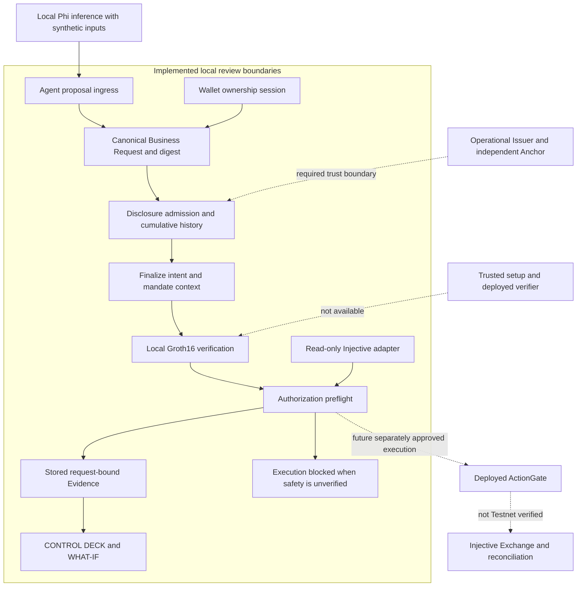
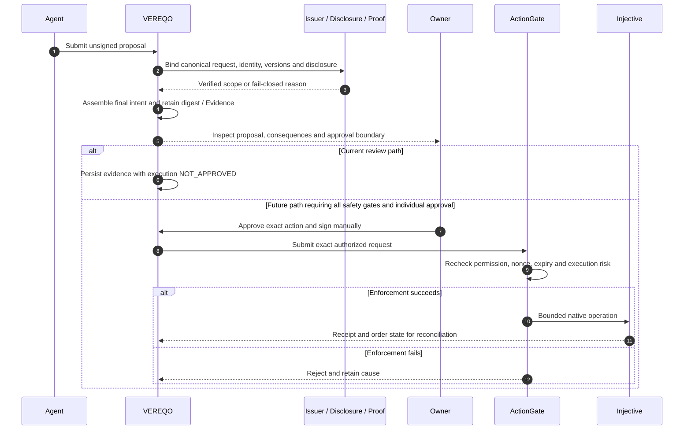
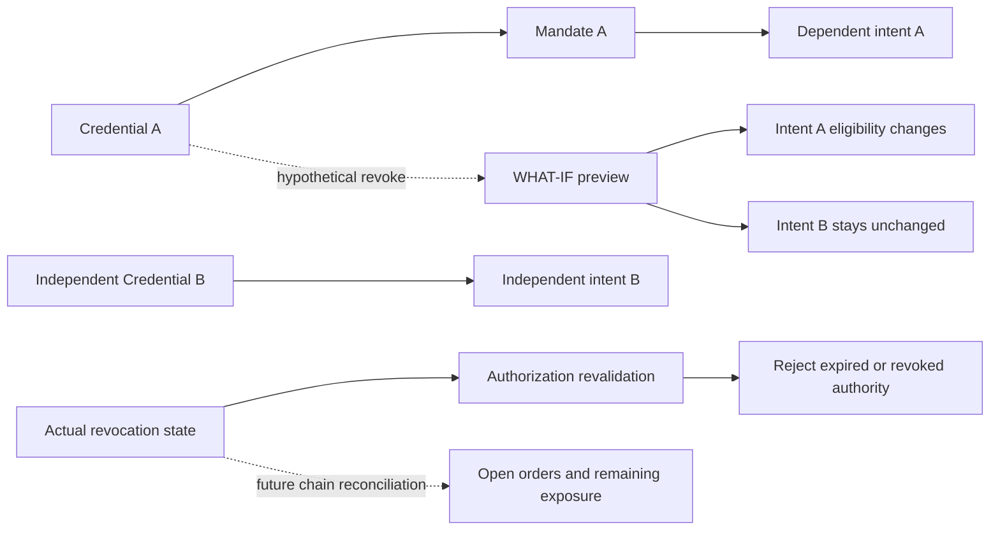
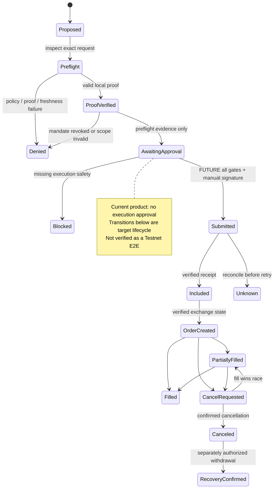

<p align="center"></p>

# VEREQO

**PROVE WHAT MATTERS. CONTROL WHAT FOLLOWS.**

**Understand an AI's financial intent. Verify only what matters. Control exactly what follows.**

[English](README.md) · [日本語](README.ja.md)

## The Problem — A PROPOSAL IS NOT PERMISSION

A financial agent can propose an order in seconds. A reviewer still needs to know who requested it, which confidential conditions apply, what authority exists, and what could change if that authority is revoked.

A proof, a wallet connection, and a trading mandate establish different facts. Combining them into one green status hides the decision that matters: **may this exact action proceed, under these exact conditions?**

VEREQO began with a broader question: how can an organization answer a precise question about protected information without exposing the underlying data, while making the downstream consequences inspectable?

## The Product — UNDERSTAND / SIMULATE / CONTROL

VEREQO is the decision instrument between an Agent's request and a financial action.

| Mode | What the reviewer gains |
| --- | --- |
| **UNDERSTAND** | Read the proposed action, its units, source, authority and evidence. |
| **SIMULATE** | Compare a hypothetical credential or policy change with the current dependencies. |
| **CONTROL** | Keep disclosure admission, ownership, mandate, proof and execution permission explicit. |

The current product combines a working local disclosure and consequence instrument, request-bound review/Evidence paths, and read-only Injective Testnet observations. Financial execution remains **NO-GO / NOT_IMPLEMENTED**.

## Financial Use Case

The intended customers are trading operators, liquidity providers, risk teams and organizations reviewing constrained work delegated to external Agents.

Imagine an Agent proposing a Spot BUY LIMIT order for **40 INJ at 12 USDT**, with a maximum nominal exposure of **480 USDT**. These are **SYNTHETIC illustrative values**, not a live quote or order record.

The reviewer asks whether an issuer-approved private mandate covers that exact exposure without revealing its confidential ceiling. VEREQO makes the request, proof scope, permitted disclosure, mandate and downstream dependencies inspectable. It keeps the final owner signature and financial execution behind separate gates.

A real local Phi model has generated a schema-valid unsigned proposal from explicitly synthetic inputs. This is **LOCAL VERIFIED inference**, not live-market autonomous trading; synthetic adapters used later in that experiment do not establish operational Issuer, Anchor or financial E2E success.

## CONTROL DECK — White Instrument

One selected request provides the context for the precision dial, physical-style keys, 34-bar LCD, directed dependency view and Evidence Inspector. The White Instrument design uses restrained spacing and motion to reveal state and cause.

| Surface | Product purpose and present boundary |
| --- | --- |
| **Disclosure** | Admit bounded questions before releasing an answer; retain cumulative local history. The finite reference dataset is synthetic. |
| **Consequence** | Follow explicit directed dependencies and inspect affected versus independent claims. |
| **WHAT-IF** | Preview eligibility changes without committing a revocation or changing onchain authority. |
| **Evidence** | Inspect stored request IDs, digests, versions, decisions and provenance. Loading a record does not rerun proof verification. |
| **Financial inspection** | Inspect Spot/Derivative drafts and explicitly fetched Testnet observations. Draft controls do not submit orders. |

The synthetic disclosure example narrows 128 → 101 → 81 possibilities and refuses a further threshold-70 question when its 71/10 split violates the policy. This demonstrates bounded disclosure behavior, not the protection of a live financial portfolio.

## Why Injective

Injective gives the intended product a concrete financial environment rather than an abstract transaction destination:

1. **Native exchange semantics:** Spot/Derivative markets, subaccounts and order states give a request precise financial meaning.
2. **EVM-to-Exchange boundary:** the Exchange Precompile interface gives the Solidity Gate a defined integration surface. Direct and Proxy authority must be evaluated separately; this prototype follows the Direct path.
3. **Wallet tooling:** EIP-712 and EVM tooling support explicit ownership and exact-intent signing boundaries.
4. **Agent integration:** structured Agent proposals can feed the review layer while signing and sending remain outside Agent authority. No Injective MCP integration is claimed by this release.
5. **Permission-aware assets:** issuer restrictions provide a relevant future use case for credentials and asset-level policy. Production asset integration is not verified.
6. **Observable outcomes:** chain and Exchange reads can support receipt/order reconciliation. This is an integration goal, not a verified live execution lifecycle.

EVM Testnet chain **1439** and native network **injective-888** serve different interfaces. Independent RPC, LCD and Indexer observations are not one atomically pinned state.

## System Architecture

Solid paths describe implemented local review boundaries; dashed paths identify external trust or future execution dependencies. This is a product architecture map, **not evidence of a production end-to-end deployment**. The displayed Request ID supports correlation; cryptographic digests, signatures and checks provide their own limited guarantees. External request fields are not claimed to be proved inside a Groth16 circuit unless that circuit actually includes them.



## Request Lifecycle

The request is normalized before its final intent is assembled after disclosure. Stored digests and versions support consistency checks across the review path. Full operational Agent → independent Issuer → trusted proof → chain execution is still unverified.



## Revocation & Dependencies

Revoking a dependency must change the eligibility of dependent actions while preserving independent ones. A valid proof cannot override revoked authority. WHAT-IF is a local simulation; actual revocation and existing open-order exposure require separate authority and reconciliation. The local graph demonstrates this distinction; the live order reconciliation path below remains a target.



## Financial State Lifecycle

Authorization, submission, chain inclusion, order creation, partial fills, cancellation and recovery are distinct states. The diagram includes the intended future financial lifecycle; the current product records review/preflight evidence and blocks unapproved or unverifiable execution. A returned order hash would not by itself prove a fill.



## Repository Structure / Technology

| Path | Technology and responsibility |
| --- | --- |
| `apps/web/` | React, TypeScript, Vite; English-first UI with explicit JP selection; approved solid wordmark and local OFL fonts. |
| `packages/` | Request/intent types, policy, disclosure, consequence and financial domain adapters. |
| `services/issuer/` | Node.js HTTP boundary, local SQLite persistence, authentication and preview records. |
| `contracts/` | Solidity ActionGate, verifier interfaces, Direct Exchange boundary and Foundry tests. |
| `circuits/` | Local Circom circuit source; production trusted setup is absent. |
| `tests/` | Vitest regression and adversarial cases; local/mock results retain their environment labels. |
| `scripts/` | Local development and verification tools; some historical evidence tools require local artifacts excluded from this release. |

Current supporting documents: [Architecture](docs/ARCHITECTURE.md), [Security](docs/SECURITY.md), [Release validation](docs/RELEASE_VALIDATION.md).

## Verified Today / Not Yet Verified

This is a status summary of recorded evidence, not a new live network/session check. Independent successes are not combined into an operational E2E claim.

| Area | Recorded result | Remaining condition |
| --- | --- | --- |
| Wallet ownership | **REAL, historical PASS:** server verified a real MetaMask ownership session. | Short-lived session expired; no current session or execution permission is inferred. |
| Phi proposal | **LOCAL VERIFIED:** real local inference on **SYNTHETIC** market inputs. | Operational Agent/provider and independent downstream trust remain unverified. |
| Groth16 | **LOCAL VERIFIED:** proof generation and verification. | Single-machine setup is untrusted for production; trusted ceremony and verifier deployment absent. |
| Disclosure / graph / WHAT-IF | Implemented local admission, cumulative checks, dependency simulation and refusal paths. | Local SQLite is not an independent disclosure Anchor. |
| Evidence / CONTROL DECK | Implemented saved-record review and digest/context display. | Display alone does not reverify cryptography or prove external causality. |
| Injective / T5 | **TESTNET READ:** read-only observation integrated; unsafe or unverified market state fails closed. | Last recorded scan found no fresh two-sided book within the configured 10-second threshold. A snapshot is only preflight evidence. |
| T6 / ActionGate | **LOCAL** Foundry/mock coverage. | Complete Testnet deployment, funding, order, cancel, withdrawal and principal recovery E2E unverified. |
| Release build | Recorded typecheck/build PASS and English-first checks **2/2**. | No new full-suite test total is asserted. See the dated release validation record. |

No Testnet trade, funded Gate deployment or autonomous financial execution is claimed. No draft film URL is published. Private raw evidence, Wallet footage, HAR and local databases stay outside this release.

## Roadmap / Next Milestones

1. Configure an operational Agent and managed Issuer; verify real credential issuance and revocation.
2. Connect an independently trusted disclosure Anchor with monotonic history and CAS conflict rejection.
3. Complete a circuit-specific trusted setup and verify the intended deployed verifier.
4. Establish fresh market data and trusted execution-time risk checks; preflight freshness alone is insufficient.
5. With individual owner approvals, deploy and reconcile a bounded Testnet Deposit → Order → Cancel/Withdraw/Recovery lifecycle.
6. Verify one Business Request across all operational boundaries, then prepare approved public media and submission.

## Run Locally / Tests / Security

Requires Node.js `>=22.13.0 <23` or `>=24`; npm. Foundry is needed for Solidity tests. Keep the local service on loopback and use synthetic data for the reference demo.

```sh
npm ci
npm run typecheck
npm run build
npm run dev
```

Open `http://127.0.0.1:5173/` while the service runs; the local API uses port `4317`. First-visit rendering is English; an explicitly selected Japanese preference is retained. Build output is `dist/web`. For a future Vercel project, configure that output directory; no deployment is implied.

```sh
npm test
npm run test:contracts
```

These commands run local tests; their success would not establish live financial execution. Artifact-dependent proof/evidence tools require separately prepared local inputs. No historic full-suite counts are presented as current results.

The last release scan found no secrets in the selected snapshot/base history and no production dependency advisories. It recorded 15 low-severity development-tool advisories, no moderate/high/critical findings, and a Vite chunk-size advisory. These are dated scan results, not a guarantee against future vulnerabilities. `.vercelignore` preserves build assets while excluding local state, media and internal evidence. Never commit credentials, session tokens, signatures, raw HAR or SQLite data.

## Demo & The Principle

**Product film:** the final owner-approved Vimeo URL will be added here after quality, privacy and rights review. No placeholder URL is provided. Supplied brand distribution rights remain unspecified; local OFL font notices are included.

**Every proof is a move. Not every move should be made.**

VEREQO brings the request, the reason, the authority and the consequence onto one inspectable surface.

**PROVE WHAT MATTERS. CONTROL WHAT FOLLOWS.**
